<div align="center">



<br/>

<a href="https://linkedin.com/in/rayyan-afroz-ahmed-15060b418"></a>
&nbsp;
<a href="mailto:rayyanafroz.ahmed1233@gmail.com"></a>

</div>

<br/>


<table>
<tr>
<td width="50%" valign="middle">

```text
$ whoami
> rayyan afroz

$ cat passion.txt
> An individual passionate about tech.
> Backend APIs, cloud, and clean UIs.

$ status
> online. building. shipping. _
```

</td>
<td width="50%" align="center" valign="middle">

</td>
</tr>
</table>


<h4>&gt; Programming Languages</h4>
<p>


</p>

<h4>&gt; Frontend</h4>
<p>


</p>

<h4>&gt; Backend & APIs</h4>
<p>


</p>

<h4>&gt; Databases</h4>
<p>

</p>

<h4>&gt; AI / ML</h4>
<p>


</p>

<h4>&gt; Cloud & Hosting</h4>
<p>


</p>

<h4>&gt; DevOps & Infra</h4>
<p>


</p>

<h4>&gt; Tools & Utilities</h4>
<p>


</p>


<div align="center">


</div>


<div align="center">
<picture>
  <source media="(prefers-color-scheme: dark)" srcset="https://raw.githubusercontent.com/rayyanafroz/rayyanafroz/output/github-snake-dark.svg"/>
  <source media="(prefers-color-scheme: light)" srcset="https://raw.githubusercontent.com/rayyanafroz/rayyanafroz/output/github-snake.svg"/>
  
</picture>
</div>


<div align="center">

</div>

<div align="center">


<a href="https://visitcount.itsvg.in"></a>

</div>

<!-- Proudly created with GPRM ( https://gprm.itsvg.in ) -->
